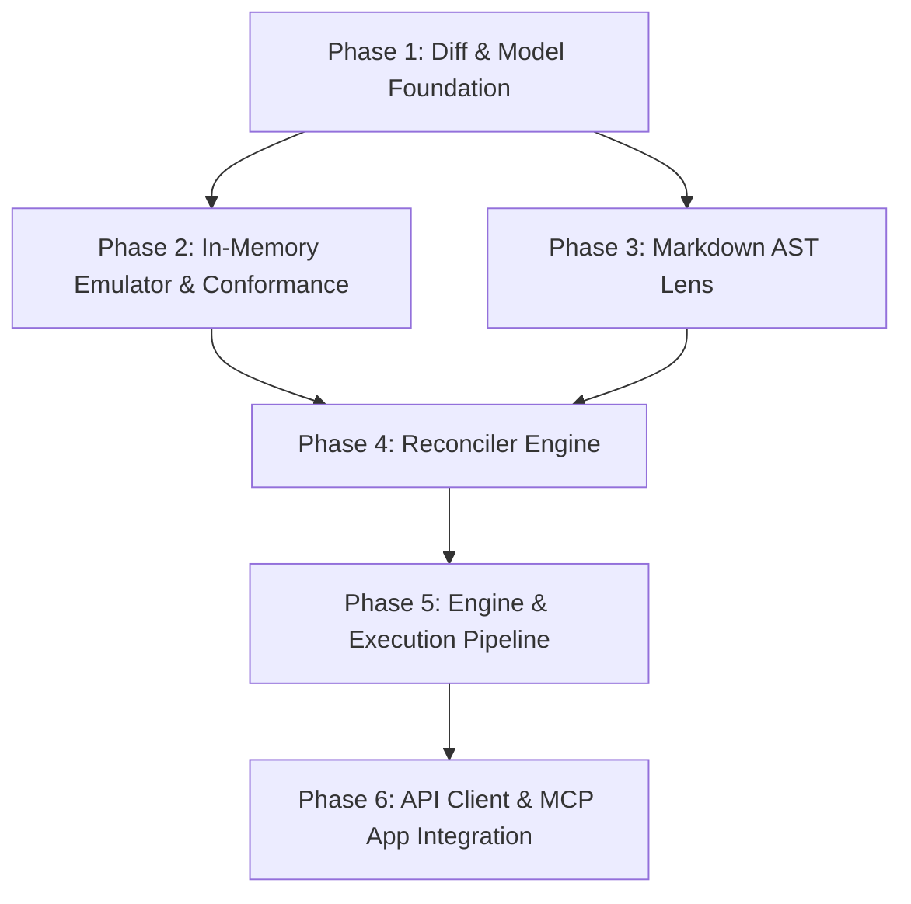

# Plan: Full File, Structure, and Test Parity for `gdocsmith-mcp`

## Current acceptance status — 🔄

**CURRENT — bounded qualification completed 23:00:29Z:** fresh Debug/Release
each 398/398 cases and 6,521/6,521 assertions, zero failures/skips; test builds
and test-TU tidy passed. Shared source 151/151, target 172/172, controls 70/70
(six backend faults), including V008 export line 13. Independent actual-Node
V008 controls/2/39 sanitizer review approved; both source-grounded fixture fixes
passed full suites. Recheck 219.022s; shared execution 5.828s. Prior app/adapter
builds/two tidies/isolated MCP passes retained only after exact input/binary
identity verification. Original 846 baseline valid; commands ended/writers idle.
**Broader Node parity/release acceptance NOT granted:** 250 raw leaves/206 groups,
foreign-error phase/tab/line/details, complete 846-case assertion transfer,
platform/raw-interchange qualifications remain open.
[Fresh handoff](../threads/2026.11.13%2020.00%20-%20Node%20parity%20gap%20closure/tasks/parity-evidence/resumed-final-recheck/handoff.md).

### Historical resumed checkpoint — superseded by fresh qualification

**RESUMED 22:37Z — current checkpoint:** export case now accessible; parent
reviewed/accepted a fixture-only correction without production changes.
Simple table-cell text uses inline rows; bold/body/image/table/header assertions
retained, public-envelope no-op/model-equality checks added. Fatal exact 1/23,
export subset 10/151 and affected lint passed. Fresh parity-only probe completed
in 5.797 seconds with current adapter/stable inputs, zero launch failures:
source 151/151, target 171/172, controls 69/70 (all six backend faults),
250 unaccepted raw leaves/206 groups. Runtime idle awaiting V008's missing
second hidden-block branch repair and fresh frozen proof; no final success.
Foreign-error metadata, raw/platform/test-transfer limitations remain.
Earlier complete differential took 6.455 seconds; wrapper termination at 3.894
seconds does not imply inherently slow/hung parity.

### Historical stop receipt — superseded by resumption

**STOPPED PARTIAL — final receipt:** Debug and Release each 396/397 cases,
6,475/6,476 assertions passed, zero skipped. Sole failure: policy-excluded export;
no inspection/reconstruction/fix or full-suite/release acceptance. All builds,
three tidies, MCP, scoped engine/API/atomic/person/lens regressions and exact
`s1`/`s10` collision regression passed. Final differential timed out; fresh
post-final-fix counts/controls/raw results remain unverified. Prior differential
151 original/171-of-172 target/69-of-70 controls/250 raw leaves is historical,
not V008 runtime closure or 70/70 controls. Foreign metadata, raw/platform and
test-transfer residuals remain. Source identities frozen unchanged; no owned
commands running. [Final summary](../threads/2026.11.13%2020.00%20-%20Node%20parity%20gap%20closure/tasks/parity-evidence/6c-final-qualification/final-summary.json).

The following checkpoint is historical and superseded numerically above:

This plan's original file/checklist targets below are retained as history, not
proof that matching files, suite totals or green subsets preserve Node behavior.
Current execution and parent-owned acceptance live in the
[parity map](../threads/2026.11.13%2020.00%20-%20Node%20parity%20gap%20closure/plans/parity/map.md).

- ✅ Independent scoped atom-helper and lens A1–A6 repair approval; the latest
  actual lens recheck passed seven selected cases/68 assertions with source,
  executable and freshness checks. This covers lens intent, not every backend.
- ✅ Scoped auth 2/36, dropdown 3/75, new-tab and rollback-boundary 5/66 independently
  accepted; postqualification API/test-fixture corrections have static approval.
- 🔄 Lens grammar/immutable-context/separator/hidden-inserted-paragraph repair
  has worker 76/622 and actual Node proof; final-review `s1`/`s10` prefix repair
  remains active. Invalid-person helper mutation repair has actual Node
  six-invalid/three-valid, focused 2/31 and public-transaction 1/6 evidence;
  final tied-source review remains pending.
- 🛑 Latest complete Debug/Release qualification is red: 391/395 cases, 39
  assertion failures each, zero skipped; builds/three tidies/MCP passed.
  Subsequent fixes await fresh full gates. Failed/unavailable excluded export
  validation remains a residual, not an implicitly closed gate.
  Earlier 308 cases/5,302 assertions are bounded historical completion only.
- 🔄 Full meaningful source-test transfer remains incomplete. The
  [43-group ledger](../threads/2026.11.13%2020.00%20-%20Node%20parity%20gap%20closure/plans/parity/obligations.md)
  and [foundation report](../threads/2026.11.13%2020.00%20-%20Node%20parity%20gap%20closure/plans/parity/baseline-transfer.md)
  preserve partial/missing/unverified distinctions; no all-846-source-case claim.
  Latest differential passed 151 original assertions, 171/172 target assertions
  and 69/70 controls, retaining 250 unaccepted raw leaves, not 250 demonstrated
  bugs. Foreign-error metadata/raw differences remain open. No current-source
  final/frozen receipt is claimed.

Apple IANA/Unicode handling is platform-qualified. Native/source/legacy envelope
recognition and selected strict-parser proofs do not establish broad raw-file
interchange. [User-facing boundaries](../../docs/features.md) separate reviewed
lens/atom intent, pending backend workflows and genuinely unsupported operations.
Parent owns acceptance; no source behavior is retired by this documentation.

## Executive Summary

The original proposal targeted **zero behavioral loss** and complete auditability
by matching the Node.js implementation (`gdocsmith` v3.0.20) with 1:1 file,
module, algorithm and test structure. The active gate instead requires verified
behavior and meaningful assertion/parameter transfer; structural similarity is
not a guarantee. The remaining proposal and progress tables are historical.

The current monolithic `src/engine.hpp` will be retired in favor of the modular subsystems from the Node.js architecture (`model/`, `diff/`, `lens/`, `reconcile/`, `emulator/`, `engine/`). Every unit test suite and the 40 real-world conformance fixtures will be ported to C++ (`slimr::test`), providing deterministic offline verification under Clang AddressSanitizer (ASan) and UndefinedBehaviorSanitizer (UBSan).

---

## Target Project Directory Structure

```
plugins/gdocsmith-mcp/
├── src/
│   ├── model/
│   │   ├── types.hpp
│   │   ├── raw_json.hpp
│   │   ├── style_values.hpp
│   │   ├── symbols.hpp
│   │   ├── object_ids.hpp
│   │   ├── lists.hpp
│   │   ├── list_presets.hpp
│   │   ├── api_facts.hpp
│   │   ├── layout.hpp
│   │   ├── equivalence.hpp
│   │   ├── walk.hpp
│   │   ├── keys.hpp
│   │   ├── from_json.hpp
│   │   ├── to_json.hpp
│   │   ├── suggestions.hpp
│   │   └── errors.hpp
│   ├── diff/
│   │   ├── myers.hpp
│   │   └── unified.hpp
│   ├── lens/
│   │   ├── directives.hpp
│   │   ├── frontmatter.hpp
│   │   ├── document.hpp
│   │   ├── parse.hpp
│   │   ├── render.hpp
│   │   ├── project.hpp
│   │   ├── put.hpp
│   │   ├── tables.hpp
│   │   ├── cell_refs.hpp
│   │   ├── cell_styles.hpp
│   │   ├── paragraph_styles.hpp
│   │   ├── named_styles.hpp
│   │   ├── named_ranges.hpp
│   │   ├── sections.hpp
│   │   ├── suggestion_blocks.hpp
│   │   ├── review_markers.hpp
│   │   ├── dropdowns.hpp
│   │   ├── hidden_chips.hpp
│   │   ├── images.hpp
│   │   └── links.hpp
│   ├── reconcile/
│   │   ├── context.hpp
│   │   ├── requests.hpp
│   │   ├── paragraph.hpp
│   │   ├── container.hpp
│   │   ├── lists.hpp
│   │   ├── tables.hpp
│   │   └── reconcile.hpp
│   ├── emulator/
│   │   ├── field_mask.hpp
│   │   ├── emulate_tables.hpp
│   │   ├── emulate.hpp
│   │   ├── fake_google.hpp
│   │   └── conformance.hpp
│   ├── engine/
│   │   ├── artifacts.hpp
│   │   ├── load.hpp
│   │   ├── export.hpp
│   │   ├── import.hpp
│   │   ├── guard.hpp
│   │   ├── plan.hpp
│   │   ├── session.hpp
│   │   ├── transaction.hpp
│   │   └── flush.hpp
│   ├── api.hpp
│   ├── app.hpp
│   └── main.cpp
└── tests/
    ├── test_main.cpp
    ├── fixtures/conformance/      # Ported 40 JSON test cases (C01a..C25a, S1..S4, M1..M4, X1..X4)
    ├── model/
    │   ├── test_style_values.hpp
    │   ├── test_symbols.hpp
    │   ├── test_object_ids.hpp
    │   ├── test_lists.hpp
    │   ├── test_layout.hpp
    │   ├── test_equivalence.hpp
    │   └── test_from_json.hpp
    ├── diff/
    │   ├── test_myers.hpp
    │   └── test_unified.hpp
    ├── lens/
    │   ├── test_directives.hpp
    │   ├── test_frontmatter.hpp
    │   ├── test_document.hpp
    │   ├── test_parse.hpp
    │   ├── test_render.hpp
    │   ├── test_project.hpp
    │   ├── test_put.hpp
    │   ├── test_tables.hpp
    │   ├── test_cell_refs.hpp
    │   ├── test_named_styles.hpp
    │   ├── test_named_ranges.hpp
    │   ├── test_sections.hpp
    │   ├── test_suggestion_blocks.hpp
    │   ├── test_review_markers.hpp
    │   ├── test_dropdowns.hpp
    │   ├── test_images.hpp
    │   └── test_links.hpp
    ├── reconcile/
    │   ├── test_paragraph.hpp
    │   ├── test_container.hpp
    │   ├── test_lists.hpp
    │   ├── test_tables.hpp
    │   ├── test_reconcile.hpp
    │   └── test_fuzz.hpp
    ├── emulator/
    │   ├── test_emulate.hpp
    │   ├── test_emulate_structure.hpp
    │   ├── test_emulate_tables.hpp
    │   ├── test_fake_google.hpp
    │   └── test_conformance.hpp
    └── engine/
        ├── test_artifacts.hpp
        ├── test_load.hpp
        ├── test_export.hpp
        ├── test_import.hpp
        ├── test_guard.hpp
        └── test_transaction.hpp
```

---

## Detailed Phase Breakdown with File Checklists

### Phase 1: Core Foundation (Diff & Model)

Port the fundamental data representations, JSON parsers, Myers diff, symbol streams, and equivalence models.

#### File Checklist
- [x] `src/diff/myers.hpp` (Myers diff on string tokens and symbol streams)
- [x] `src/diff/unified.hpp` (Unified diff formatting for mismatch reports)
- [x] `src/model/types.hpp` (DocModel, TabModel, Block, Paragraph, Table, Inline, Atom)
- [x] `src/model/raw_json.hpp` (Typed JSON utilities and object representation)
- [x] `src/model/errors.hpp` (CoreError, FileProblem, problem collectors)
- [x] `src/model/api_facts.hpp` (API defaults, style field constants, point limits)
- [x] `src/model/style_values.hpp` (Text and paragraph style equality, diff masks)
- [x] `src/model/symbols.hpp` (Symbol tokens, code units, UTF-16 length, hidden chip U+E907)
- [x] `src/model/object_ids.hpp` (Persistent object keys and ID tracking)
- [x] `src/model/list_presets.hpp` (Google Docs list preset tables)
- [x] `src/model/lists.hpp` (List models and nesting helpers)
- [x] `src/model/walk.hpp` (Recursive block, inline, and atom traversal)
- [x] `src/model/keys.hpp` (Stable key allocator)
- [x] `src/model/from_json.hpp` (Google Docs API JSON parser to DocModel)
- [x] `src/model/to_json.hpp` (DocModel to Google Docs API request converter)
- [x] `src/model/layout.hpp` (Document layout, start/end index resolution)
- [x] `src/model/equivalence.hpp` (docModelsCompare for AST equivalence)
- [x] `src/model/suggestions.hpp` (Suggestion model and symbol mark extractors)

#### Test Checklist
- [x] `tests/diff/test_myers.hpp`
- [x] `tests/diff/test_unified.hpp`
- [x] `tests/model/test_style_values.hpp`
- [x] `tests/model/test_symbols.hpp`
- [x] `tests/model/test_object_ids.hpp`
- [x] `tests/model/test_lists.hpp`
- [x] `tests/model/test_layout.hpp`
- [x] `tests/model/test_equivalence.hpp`
- [x] `tests/model/test_from_json.hpp`

---

### Phase 2: In-Memory Emulator & Conformance Harness

Port the Google Docs in-memory batchUpdate simulator and setup the 40 conformance fixtures. This establishes the offline regression harness.

#### File Checklist
- [x] `src/emulator/field_mask.hpp` (Field mask parsing and application)
- [x] `src/emulator/emulate_tables.hpp` (Table insertion, row/column/cell mutations in emulator)
- [x] `src/emulator/emulate.hpp` (Full Docs API batchUpdate simulation)
- [x] `src/emulator/fake_google.hpp` (Mock Docs & Drive API server)
- [x] `src/emulator/conformance.hpp` (Test runner for JSON conformance fixtures)
- [x] `tests/fixtures/conformance/` (Copy 40 JSON test files: `C01a.json`..`C25a.json`, `S1`..`S4`, `M1`..`M4`, `X1`..`X4`)

#### Test Checklist
- [x] `tests/emulator/test_emulate.hpp`
- [x] `tests/emulator/test_emulate_structure.hpp`
- [x] `tests/emulator/test_emulate_tables.hpp`
- [x] `tests/emulator/test_fake_google.hpp`
- [x] `tests/emulator/test_conformance.hpp` (All fixtures pass 100%)

---

### Phase 3: Markdown AST Lens (Parser, Renderer, Directives)

Port the bi-directional markdown envelope, token parser, directives, table representation, and style projections.

#### File Checklist
- [x] `src/lens/directives.hpp` (Directive attribute parsing: `::tab`, `:person`, etc.)
- [x] `src/lens/frontmatter.hpp` (YAML frontmatter parsing, validation, and generation)
- [x] `src/lens/document.hpp` (Envelope format, tabs, comments, suggestions, segment lines)
- [x] `src/lens/dropdowns.hpp` (Dropdown chip parsing and lists)
- [x] `src/lens/hidden_chips.hpp` (Unsupported / lone chips labeling)
- [x] `src/lens/links.hpp` (Document links, bookmarks, heading link resolution)
- [x] `src/lens/sections.hpp` (Section break settings and styles)
- [x] `src/lens/named_styles.hpp` (Document-level named styles export and apply)
- [x] `src/lens/named_ranges.hpp` (Named range tracking and edge indexes)
- [x] `src/lens/paragraph_styles.hpp` (Paragraph style declarations and parsing)
- [x] `src/lens/cell_styles.hpp` (Cell background, padding, alignment declarations)
- [x] `src/lens/cell_refs.hpp` (Cell reference syntax: `:cell{ref=name}`)
- [x] `src/lens/tables.hpp` (Table AST, cell merges `:merge{left/up}`, multi-block cells)
- [x] `src/lens/images.hpp` (Image dimensions, source URIs, aspect ratio)
- [x] `src/lens/review_markers.hpp` (Review marks and comment anchor markers)
- [x] `src/lens/suggestion_blocks.hpp` (Suggestion block parsing and `reject` extraction)
- [x] `src/lens/project.hpp` (DocModel to editable projection tokens)
- [x] `src/lens/parse.hpp` (Recursive token-based Markdown parser)
- [x] `src/lens/render.hpp` (Projection tokens to Markdown string)
- [x] `src/lens/put.hpp` (Apply edited projection back onto DocModel)

#### Test Checklist
- [x] `tests/lens/test_directives.hpp`
- [x] `tests/lens/test_frontmatter.hpp`
- [x] `tests/lens/test_document.hpp`
- [x] `tests/lens/test_dropdowns.hpp`
- [x] `tests/lens/test_links.hpp`
- [x] `tests/lens/test_sections.hpp`
- [x] `tests/lens/test_named_styles.hpp`
- [x] `tests/lens/test_named_ranges.hpp`
- [x] `tests/lens/test_tables.hpp`
- [x] `tests/lens/test_cell_refs.hpp`
- [x] `tests/lens/test_images.hpp`
- [x] `tests/lens/test_review_markers.hpp`
- [x] `tests/lens/test_suggestion_blocks.hpp`
- [x] `tests/lens/test_project.hpp`
- [x] `tests/lens/test_parse.hpp`
- [x] `tests/lens/test_render.hpp`
- [x] `tests/lens/test_put.hpp`

---

### Phase 4: Reconciler Engine (Paragraph, Container, Lists, Tables)

Implement the exact reconciliation algorithms from Node.js, eliminating paragraph-wide formatting, fixing gap handling, and supporting full table edits.

#### File Checklist
- [x] `src/reconcile/requests.hpp` (Typed Google Docs request builder)
- [x] `src/reconcile/context.hpp` (ReconcileContext, request push, origin tracking)
- [x] `src/reconcile/paragraph.hpp` (Character-level Myers diff, per-span `updateTextStyle`, carry moves)
- [x] `src/reconcile/lists.hpp` (List ID mapping, bullet preset changes, nesting levels 0..8)
- [x] `src/reconcile/tables.hpp` (Table cell reconciliation, row/col operations, merge/unmerge)
- [x] `src/reconcile/container.hpp` (Block alignment by key, gap reconciliation, terminal newline preservation)
- [x] `src/reconcile/reconcile.hpp` (Top-level document reconcile coordinator and emulator self-check)

#### Test Checklist
- [ ] `tests/reconcile/test_paragraph.hpp`
- [ ] `tests/reconcile/test_lists.hpp`
- [ ] `tests/reconcile/test_tables.hpp`
- [ ] `tests/reconcile/test_container.hpp`
- [ ] `tests/reconcile/test_reconcile.hpp`
- [ ] `tests/reconcile/test_fuzz.hpp` (Random insertions, deletions, replacements through emulator)

---

### Phase 5: Engine & Execution Pipeline (Guards, Transactions, Flushing)

Port the pre-send safety guard engine, multi-phase execution pipeline, and real post-write verification.

#### File Checklist
- [ ] `src/engine/artifacts.hpp` (Working directories, export folder structure, file replacement, write tracker)
- [ ] `src/engine/load.hpp` (Plain-text anchor matching with `[a]`, `[b]` markers, quote fallback)
- [ ] `src/engine/guard.hpp` (Pre-send guard engine: `commentChanges`, `brokenLink`, `namedRangeDamage`, `lossyImageMove`, `lossyListRebuild`)
- [ ] `src/engine/plan.hpp` (DocPlan packaging and finding resolution)
- [ ] `src/engine/session.hpp` (CoreSession, in-memory ledger, provisional ID resolution)
- [ ] `src/engine/flush.hpp` (Chunked batch updates up to 2000 requests, revision locking, live verification)
- [ ] `src/engine/transaction.hpp` (Multi-phase transaction runner: Structure, Content, Styles, Comments, Verification)
- [ ] `src/engine/export.hpp` (`fileExport`, image downloading, comment block assembly)
- [ ] `src/engine/import.hpp` (`fileImport`, document creation `doc: null`, `newDocStyleBaseline`)

#### Test Checklist
- [ ] `tests/engine/test_artifacts.hpp`
- [ ] `tests/engine/test_load.hpp`
- [ ] `tests/engine/test_guard.hpp`
- [ ] `tests/engine/test_export.hpp`
- [ ] `tests/engine/test_import.hpp`
- [ ] `tests/engine/test_transaction.hpp`

---

### Phase 6: API Client & App Integration

Connect the engine to Docs and Drive API clients, MCP endpoints, CLI commands, and retire monolithic `src/engine.hpp`.

#### File Checklist
- [x] `src/api.hpp` (Update `DocsClient` and `DriveClient` with `createDocument`, comments API, and image uploads)
- [ ] `src/app.hpp` (MCP registration: `export`, `import`, `file`, `status`, resource `gdocsmith://guide`)
- [ ] `src/main.cpp` (Streamable HTTP, stdio MCP, CLI direct execution modes)
- [ ] Retire / remove `src/engine.hpp` and `src/storage.hpp`
- [ ] `tests/test_main.cpp` (Include all test headers)
- [ ] Update `CMakeLists.txt` (Include new test headers, directories, and fixtures)

#### Verification Gate
- [ ] `just test` (All tests pass under AddressSanitizer + UndefinedBehaviorSanitizer with 0 errors/leaks)
- [ ] `just test-mcp` (July `2026-07-28` stdio and HTTP discovery pass)
- [ ] `just lint` (Clean `clang-tidy` run across all headers)

---

## Progress Tracking

| Phase | Description | Files Target | Test Suites Target | Status |
| :--- | :--- | :---: | :---: | :---: |
| **Phase 1** | Diff & Model Foundation | 17 files | 9 suites | Completed (17/17 src, 9/9 suites pass ASan/UBSan) |
| **Phase 2** | Emulator & Conformance Harness | 5 files + 40 fixtures | 5 suites + 40 fixtures | Completed (5/5 src, 149 fixtures pass ASan/UBSan) |
| **Phase 3** | Markdown AST Lens | 19 files | 17 suites | Completed (20/20 src, 17/17 suites pass ASan/UBSan) |
| **Phase 4** | Reconciler Engine | 7 files | 6 suites | In Progress (7/7 src, test suites in progress) |
| **Phase 5** | Engine & Execution Pipeline | 9 files | 6 suites | In Progress (6/9 src, 4/6 tests in progress) |
| **Phase 6** | API Client & App Integration | 3 files | Full suite verification | In Progress (api.hpp and app.hpp in flight) |

---

## Architectural Dependency Graph


