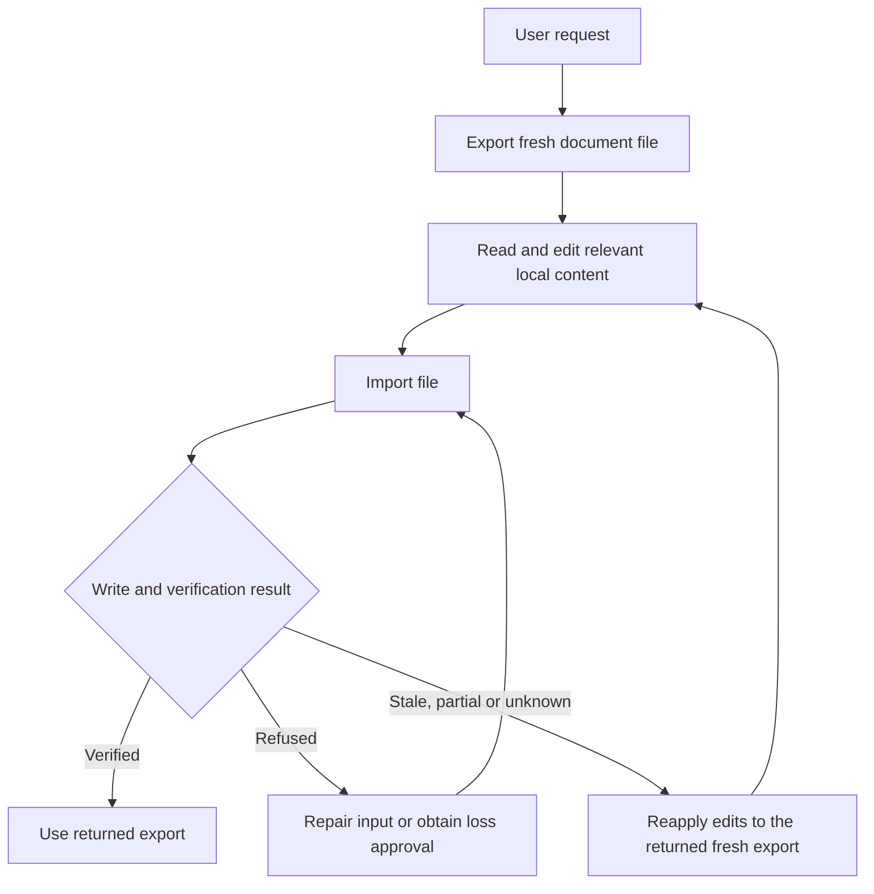

# Editing Runbook

## Practical Loop

1. Duplicate first only when the original must remain unchanged.
2. Export and search the local file; edit only the relevant content.
3. Import its absolute path. Automatic planning, guards and verification are internal.
4. Report warnings and use the returned export after verified success.
5. After stale or uncertain writes, reapply only outstanding edits to the returned fresh export.

Never invent object IDs, replace a stale revision, or calculate Google character positions. Tab structure comes from tab lines; comments and suggestion rejects are edits to the blocks at the end of the file; Drive management uses the file tool.