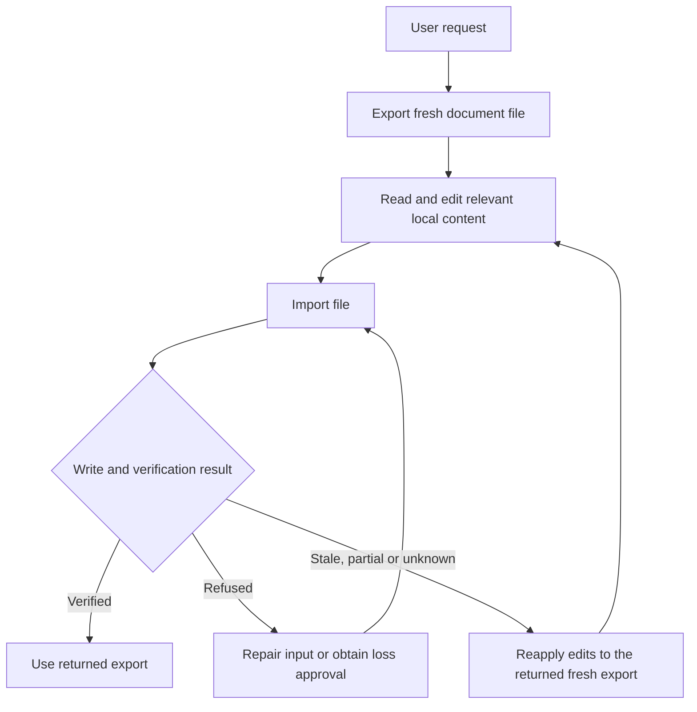

# Editing Runbook

> **Build status:** Public remote import is enabled by default and scoped
> earlier bounded implementation/runtime accepted. The historical synthetic live
> create/body-edit/export/no-op/stale-refusal/delete loop passed; broader rich
> and review mutation coverage is not implied.
> Current bounded qualification/shared checks passed; broader Node parity and
> raw-difference acceptance remain open (see [features](features.md)).
> Use the [agent guide](agent-guide.md) for reviewed lens/atom intent versus
> pending backend workflows; protected review conflicts remain restricted.
> Never blindly retry unknown
> creates/copies/comments, even if a fresh export is available.

## Practical Loop

1. Duplicate first only when the original must remain unchanged.
2. Export and search the local file; edit only the relevant content.
3. Import its absolute path. Automatic planning, guards and verification are internal.
4. Report warnings and use the returned export after verified success.
5. After stale or uncertain writes, reapply only outstanding edits to the returned fresh export.

Never invent object IDs, replace a stale revision, or calculate Google character positions.
Tab structure comes from tab lines; supported comment actions use their blocks.
Suggestion snippets/markers remain read-only; handle suggestion decisions in
Google Docs. Drive management uses the file tool.